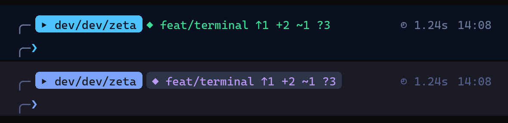

# Zeta

**The oh-my-zsh of PowerShell.** A themeable, plugin-driven prompt and shell framework that
makes Windows PowerShell and PowerShell 7 look like a modern terminal — without replacing a
single PowerShell semantic. Every cmdlet, module, and .NET type still works exactly as before.

```
╭─  ▸ ~/dev/zeta  ⎇ feat/terminal +2 ~1 ?3                                  ⏱ 1.24s  14:03
╰─❯
```



<sub>Preview rendered from Zeta's real segment model by a small PIL script (not a terminal
screenshot): same cells, palette and layout maths the prompt uses.</sub>

---

## Install

```powershell
# from this folder
.\install.ps1

# or pick a theme while installing
.\install.ps1 -Theme tokyo-night
```

Then restart the shell, or load it now:

```powershell
. $PROFILE
```

The installer is idempotent: it copies the module to your user module path, builds the Rust
sensor if `cargo` is available, adds a marker block to your PowerShell profile, and does the
same for `~/.bashrc` so Git Bash gets the themed prompt too. No admin rights, no system-wide
changes. Opt out of either with `-NoProfile` / `-NoBashProfile`.

**Requirements:** PowerShell 5.1+ (7.x recommended). Optional: `cargo` for the native sensor
(everything works without it), a Nerd Font for powerline glyphs (falls back automatically).

## Daily use

```powershell
zeta theme list                  # 6 shipped themes
zeta theme set tokyo-night       # persists to config.json
zeta plugin list                 # what is loaded, what it requires
zeta plugin add docker
zeta completion menu             # Tab -> dropdown; Shift+Tab -> inline cycling
zeta doctor                      # capability matrix + performance + fixes
zeta bench                       # prompt latency percentiles
zeta update                      # git pull + reinstall (refuses on a dirty tree)
```

## What you get

| | |
|---|---|
| **6 themes** | `zeta`, `tokyo-night`, `catppuccin-mocha`, `nord`, `gruvbox-dark`, `synthwave` |
| **20 segments** | dir, git, langs, duration, clock, exit status, kube, aws, docker, venv, battery, jobs, elevated, history, host… |
| **10 plugins** | core (`take`, `up`, `extract`), git, z, history, docker, dotnet, python, clip, dirhistory, fetch |
| **`z` jump** | frecency index: `z part-of-path`, `z -l`, `z -` — **same index in PowerShell and bash** |
| **Windows Terminal** | a real profile fragment with a matching colour scheme, not just a prompt |
| **Glyph fallback** | nerd → unicode → ascii, auto-detected, so no boxes on a fresh Windows install |

### Completion style

Tab completes either way - what changes is *how*:

| Mode | Tab does | Shift+Tab does |
|---|---|---|
| `tab` **(default)** | cycles completions inline, classic PowerShell | opens the selection dropdown |
| `menu` | opens the dropdown: arrow keys select, Enter accepts, Esc cancels | cycles inline |
| `predictive` | dropdown **plus** inline history predictions | cycles inline |

```powershell
zeta completion menu      # switch and persist
zeta completion tab       # back to classic
zeta completion           # what is actually bound right now
```

```jsonc
{ "features": { "completion": "menu" } }
```

`predictive` requires PSReadLine 2.2+ (PowerShell 7); on 5.1 it refuses with an explanation
instead of silently doing nothing. The alternate style is always one chord away on Shift+Tab,
so switching modes never leaves you without completion.

### One terminal, two shells

```powershell
zeta shell list          # pwsh / Windows PowerShell / Git Bash / WSL, with paths
zeta shell bash          # enter Git Bash here
zeta shell tab bash      # open a peer Windows Terminal tab in this directory
zeta shell tab pwsh
```

**In-place handoff** (`zeta shell bash`): Git Bash starts in the current directory, and when you
`exit`, PowerShell moves to **the directory bash ended in** - not the one you left. The return
trip works because Zeta hands bash a generated rcfile that records `$PWD` on `EXIT`; a child
process cannot change its parent's directory, so the parent reads it back and `Set-Location`s.

**Peer tabs** (`zeta shell tab ...`): a sibling tab at the same directory (`wt -w 0 new-tab -d`).
`Ctrl+Tab` jumps between them, each keeps its own history and prompt, and both are themed by the
same fragment.

`zeta shell pwsh` nests PowerShell in place; nesting cannot inherit a child's final directory,
so use a tab when you need two independent sessions.

### Same look, both shells

Bash is not a second-class guest. `zeta shell bash` hands bash a generated theme file, so the
bash prompt renders the **same theme**: same pill, same colours, same glyphs, same truncation.
A regression test asserts the two prompts are byte-identical after stripping ANSI.

| | PowerShell | Git Bash |
|---|---|---|
| prompt | `Write-ZetaPrompt` | `__zeta_build_prompt` |
| theme source | theme JSON | same JSON, compiled to `~/.zeta/theme.bash` |
| `zeta theme list` / `set` | native | native (set shells out to PowerShell) |
| `zeta doctor` | full matrix | bash-side check |
| `z` jump | plugin | not in bash (use `zeta shell tab bash` for a peer session) |

**Live, not copied once.** Changing the theme in either shell rewrites `~/.zeta/theme.bash`;
the other shell notices on its next prompts (mtime check every 10 prompts) and re-renders.
No restart, no reload command.

To theme Git Bash launched from the Start Menu (not via `zeta shell bash`):

```powershell
Install-ZetaBashProfile      # idempotent marker block in ~/.bashrc
```

### Split view: both shells at once

```powershell
zeta shell split bash     # bash beside your PowerShell, same directory
zeta shell split pwsh     # the other direction
```

A real Windows Terminal split pane (`split-pane -V`), not a tab: you see both prompts at the
same time and move between them with the pane keys. Both start in the current directory.
It must run **inside** Windows Terminal (that's where `wt -w 0` can split); outside it, Zeta
tells you so instead of silently doing nothing — use `zeta shell tab` there.

### Colour studio

```powershell
zeta ui                   # opens a local colour editor
```

Loopback-only (`127.0.0.1`) and token-gated, so nothing else on the machine can rewrite your
theme. Edit the 12 palette colours with live preview, rename to **save as a new theme**, and
**Delete** puts a built-in back (built-ins themselves are never touched — editing one creates a
deletable user override). **Apply after save** is on by default.

Saving recompiles the bash view and both shells pick it up within a few prompts — the caches are
mtime-aware, so no reload command is needed. Jump straight to a theme with
`zeta theme edit tokyo-night`.

### When the switch misbehaves

```powershell
zeta shell diagnose
```

The handoff has five links — Git Bash, the bash runtime, the compiled theme, the rcfile and the
cwd token. This checks each one and names the broken link instead of leaving you guessing.

### Themes

`zeta` (house theme, indigo/cyan) · `tokyo-night` · `catppuccin-mocha` · `nord` ·
`gruvbox-dark` · `synthwave`

Theme JSON controls the palette and the layout independently, so re-colouring never means
editing layout, and layout changes never mean touching colours.

```jsonc
{
  "palette": { "bg": "#1a1b26", "accent": "#7aa2f7", "ok": "#9ece6a", "err": "#f7768e" },
  "prompt": {
    "left":  [ { "segment": "dir", "style": "pill", "bg": "accent", "fg": "bg", "bold": true },
               { "segment": "git", "style": "plain", "fg": "ok" } ],
    "right": [ { "segment": "duration" }, { "segment": "clock" } ]
  }
}
```

Drop your own into `%LOCALAPPDATA%\Zeta\themes\` — user themes override built-ins by name.

### Plugins

Each plugin is a folder with `plugin.json` + `plugin.ps1`. User-facing commands are defined with
`function global:…`; helpers use `function script:…` so they stay inside the module.

```
Plugins/z/
  plugin.json   { "name": "z", "requires": [] }
  plugin.ps1
```

## Configuration

`%LOCALAPPDATA%\Zeta\config.json` (created on demand; defaults are merged in, so you only write
what you change). Environment overrides always win: `ZETA_THEME`, `ZETA_GLYPHS`,
`ZETA_COLOR`, `ZETA_WIDTH`, `ZETA_NO_ASYNC`, `ZETA_NO_CORE`, `ZETA_ROOT`.

```jsonc
{
  "theme": "tokyo-night",
  "plugins": ["core", "git", "z", "history"],
  "prompt": { "duration": true, "rightAlign": true, "transient": false },
  "cache":  { "git": 2000, "langs": 60000 }
}
```

## How it works (short version)

```
profile -> Import-Module Zeta -> Initialize-Zeta
                                    |
        prompt()  ->  render (PowerShell)  <-  TTL cache  <-  background runspace
                                    |                            |
                                    +-->  zeta-core.exe (Rust): git state, frecency index
```

- **PowerShell owns composition.** Themes, layout, ANSI, plugins, all user-facing cmdlets. This
  is the part you are meant to hack on.
- **Rust owns sensors.** One static binary, **zero crate dependencies**, 267 KB. It reports git
  state and maintains the frecency index. If it is missing, every sensor has a pure-PowerShell
  fallback — the shell degrades, it never breaks.
- **The prompt never blocks.** Segments declare a TTL; stale values are served while a single
  background runspace refreshes them. Rendering is memoised on a state signature.
- **Three glyph tiers and three colour depths**, auto-detected, so a fresh Windows install with
  no Nerd Font and no truecolor still looks deliberate.

Full design rationale, alternatives considered, and the roadmap: [`docs/PLAN.md`](docs/PLAN.md).
Measured numbers and limitations: [`docs/MEASURED.md`](docs/MEASURED.md).

## Develop

```powershell
.\build.ps1              # cargo test + cargo build + parse check + stage binary
.\tests\Verify.ps1       # 25 assertions, no Pester needed, runs on 5.1 and 7
cargo test --manifest-path crates/zeta-core/Cargo.toml
```

Module layout:

```
src/Zeta.psd1, Zeta.psm1
src/Private/   Compat Config Theme Render Cache Sensors Segments Prompt Plugins Terminal
src/Public/    Initialize-Zeta, theme/plugin/diagnostics/lifecycle commands, zeta dispatcher
src/Plugins/   10 plugins
src/Themes/    6 JSON themes
crates/zeta-core/  Rust sensor (std only)
```

## Uninstall

```powershell
Uninstall-Zeta               # remove the profile block only
Uninstall-Zeta -RemoveModule # also delete the installed module
```

## License

MIT.
